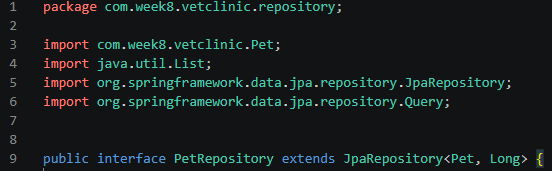
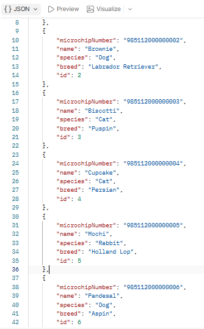
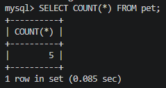
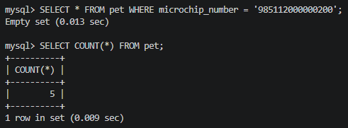
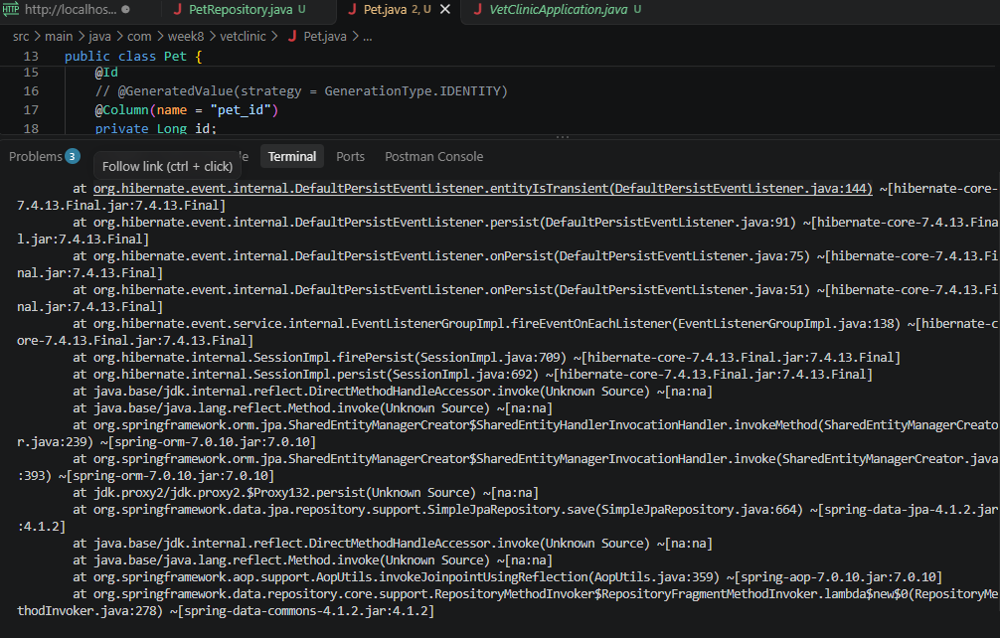
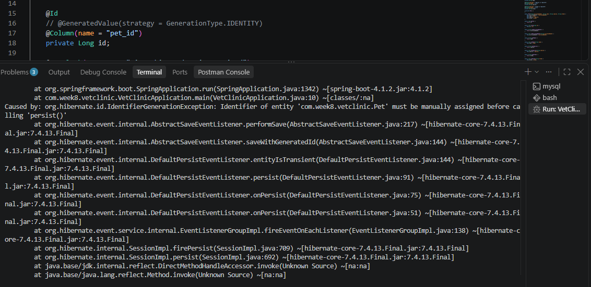

# Lab 8: Database-Backed CRUD Application

**Course:** WEBDEV2 | **Week:** 8 (Midterm)
**Project:** Vet Clinic pet catalog (Spring Boot, Spring Data JPA, MySQL)

All screenshots are in the `screenshots/` folder.

---

## Task 1: Repository Interface

`PetRepository` extends `JpaRepository<Pet, Long>`. Spring Data generates the implementation at runtime, so no method bodies and no SQL are written.

```java
public interface PetRepository extends JpaRepository<Pet, Long> {
    // Task 3 query methods are declared here
}
```

`DataSeeder` (a `CommandLineRunner`) inserts six pets at startup. `GET /api/pets` calls `findAll()` and returns them.

**Repository code**



**`findAll()` response (200 OK, seeded pets returned)**




---

## Task 2: Full CRUD via Service Layer

`PetService` receives `PetRepository` through constructor injection. `getPetById` uses `findById(id).orElseThrow(...)` and throws a custom `PetNotFoundException`, which `GlobalExceptionHandler` maps to a `404 Not Found` response. `updatePet` and `removePet` reuse `getPetById`, so an unknown id returns 404 for those operations too.

| Operation | Endpoint | Status |
|---|---|---|
| registerPet | `POST /api/pets` | 201 Created |
| getAllPets | `GET /api/pets` | 200 OK |
| getPetById | `GET /api/pets/{id}` | 200 OK (404 if absent) |
| updatePet | `PUT /api/pets/{id}` | 200 OK |
| removePet | `DELETE /api/pets/{id}` | 204 No Content |

**PetService code**


**PetController code**


**POST (201 Created)**


**GET all (200 OK)**


**GET by id (200 OK)**


**PUT (200 OK, name changed to "Rexy")**


**DELETE (204 No Content)**


---

## Task 3: Derived and Custom Query Methods

```java
List<Pet> findBySpeciesIgnoreCase(String species);

List<Pet> findByNameContainingIgnoreCase(String keyword);

@Query("SELECT DISTINCT p.species FROM Pet p")
List<String> findAllSpecies();
```

Each method has a matching method in `PetService` and a GET endpoint in `PetController`:

| Endpoint | Repository method |
|---|---|
| `GET /api/pets/species?name=dog` | `findBySpeciesIgnoreCase` |
| `GET /api/pets/search?keyword=pan` | `findByNameContainingIgnoreCase` |
| `GET /api/pets/species-list` | `findAllSpecies` |

**Repository with all three methods**


**Species filter (`?name=dog`, returns the dogs only)**


**Name search (`?keyword=pan`, returns Pandesal)**


**Distinct species list**


---

## Task 4: @Transactional and Rollback

```java
@Transactional
public void batchRegister(List<Pet> pets) {
    for (Pet p : pets) {
        petRepository.save(p);
    }
}
```

`POST /api/pets/batch` calls this method. The `microchipNumber` column has a UNIQUE constraint (`@Column(unique = true, nullable = false)`).

**batchRegister code with @Transactional**


**Row count before the batch (5 rows)**



**Failing batch: two pets with the same microchip number `985112000000200` (409 Conflict)**


**SQL log: both INSERTs were sent, the second failed with a duplicate entry**


**Database after the failed batch: no row for that chip, and the count is still 5**



### What I observed

1. Hibernate sent an `insert into pet` for the first pet, so the INSERT reached MySQL.
2. The second `insert into pet` failed with `Duplicate entry '985112000000200'` (error code 1062, SQLState 23000), because the unique constraint on `microchip_number` was violated.
3. Spring translated this into a `DataIntegrityViolationException`. This is an unchecked exception, and it left the `@Transactional` method.
4. Spring's transaction proxy rolled back the whole transaction, so the first INSERT was undone as well. The API returned `409 Conflict`.
5. `SELECT * FROM pet WHERE microchip_number = '985112000000200';` returned an empty set, and `SELECT COUNT(*) FROM pet;` returned 5 both before and after. Nothing was persisted, so the batch is atomic: either every pet is saved or none is.

---

## Task 5: Debugging a Persistence Error

I enabled SQL logging with `spring.jpa.show-sql=true` and `logging.level.org.hibernate.SQL=DEBUG`, then introduced the broken code and ran it.

### Defects found

1. `id` is missing `@GeneratedValue`.
2. The `species` field is missing from the `Pet` entity.
3. `microchipNumber` is set to `null`, which violates `nullable = false`.

### Defect 1: missing `@GeneratedValue`

**Broken entity (`@GeneratedValue` commented out) and the stack trace**



**Root cause line from the console**



**Seeder SQL log before the crash**


1. **Stack trace:** the app failed at startup, when `DataSeeder` called `save()`. The root cause was `IdentifierGenerationException: Identifier of entity 'com.week8.vetclinic.Pet' must be manually assigned before calling 'persist()'`.
2. **SQL log:** only `select ... where microchip_number=?` statements appeared (the seeder's existence check). No `insert into pet` was logged, because Hibernate rejected the entity before sending any SQL.
3. **Fix:** added `@GeneratedValue(strategy = GenerationType.IDENTITY)` to the `id` field so MySQL assigns the id.

### Defect 2: missing `species` field


1. **Stack trace:** startup failed with `PathElementException: Could not resolve attribute 'species' of 'com.week8.vetclinic.Pet'`. Spring Data validates repository queries at startup. `findBySpeciesIgnoreCase` and `SELECT DISTINCT p.species FROM Pet p` both refer to `species`, so the repository bean could not be created and the application never started.
2. **SQL log:** no SQL ran at all, because the failure happened while the repositories were being built.
3. **Fix:** restored the `species` field in `Pet` (`@Column(nullable = false) private String species;`) with its getter and setter.

### Defect 3: null `microchipNumber`

I added a temporary endpoint that called `setMicrochipNumber(null)` and then `registerPet(...)`.


1. **Stack trace:** the request returned `500 Internal Server Error` and the pet was not saved. A `null` microchip number breaks two rules on the entity: `@NotBlank` and `@Column(nullable = false)`.
2. **SQL log:** the null value is rejected by Bean Validation (`@NotBlank`) before the INSERT reaches MySQL. If the validation annotation were absent, the database would reject the INSERT itself with `Column 'microchip_number' cannot be null`. Either way, no row with a null microchip can be stored.
3. **Fix:** `microchipNumber` must always receive a valid, non-null value before `save()`. The entity keeps `@NotBlank` and `@Column(unique = true, nullable = false)`, and the temporary test endpoint was removed.

### Fixed code

Fixed entity (`Pet.java`):

```java
@Entity
@Table(name = "pet")
public class Pet {

    @Id
    @GeneratedValue(strategy = GenerationType.IDENTITY)
    @Column(name = "pet_id")
    private Long id;

    @NotBlank(message = "Microchip number is required")
    @Column(unique = true, nullable = false)
    private String microchipNumber;

    @NotBlank(message = "Name is required")
    @Column(nullable = false)
    private String name;

    @NotBlank(message = "Species is required")
    @Column(nullable = false)
    private String species;

    @NotBlank(message = "Breed is required")
    @Column(nullable = false)
    private String breed;

    // constructors, getters and setters
}
```

Fixed service call (valid, non-null microchip number):

```java
Pet p = new Pet("985112000000100", "Rex", "Dog", "Beagle");
petRepository.save(p);
```

With all three fixes in place the application starts without errors, and `POST /api/pets` returns `201 Created` with a generated id:

