# Lab 11 — Answer Template

**Course:** Web Development 2 &nbsp;|&nbsp; **Week:** 11 &nbsp;|&nbsp; **Lab:** Capstone Milestone 3

> **Instructions:** Fill in each section with links to your code and screenshots/recordings. Do not paste full file contents here — link to the file in your repository instead. Submit your GitHub repository URL to Moodle.

---

## Student Information

| Field | Value |
|---|---|
| Name | Stephanie Mhay De Leon |
| Student ID | 2510576 |
| GitHub Repository URL | https://github.com/stepanotchie/webdev2.git |
| Branch (if not `main`) | week11 |

---

## Task 1 — Input Validation on DTOs

**DTO files with annotations** :

- `CreatePetRequest.java`: [src/main/java/com/clinic/dto/request/CreatePetRequest.java](src/main/java/com/clinic/dto/request/CreatePetRequest.java)
- `UpdatePetRequest.java` (PUT): [src/main/java/com/clinic/dto/request/UpdatePetRequest.java](src/main/java/com/clinic/dto/request/UpdatePetRequest.java)
- `PatchPetRequest.java` (PATCH): [src/main/java/com/clinic/dto/request/PatchPetRequest.java](src/main/java/com/clinic/dto/request/PatchPetRequest.java)

Constraints used: `@NotBlank`, `@Size`, `@Min`, `@NotNull` and `@Email` (on the optional `contactEmail` field). `@Valid` is applied to every `@RequestBody` in [PetController.java](src/main/java/com/clinic/controller/PetController.java) (POST, PUT and PATCH).

**Evidence of 400 response for missing field:**

> Response body for `POST http://localhost:8080/api/pets` with `"name"` missing (request body: `species` = Dog, `microChipNumber` = MC-5001, `ownerId` = 1):

```json
{
    "status": 400,
    "message": "Validation failed",
    "timestamp": 1795242380671,
    "errors": [
        {
            "field": "name",
            "message": "Name is required"
        }
    ]
}
```

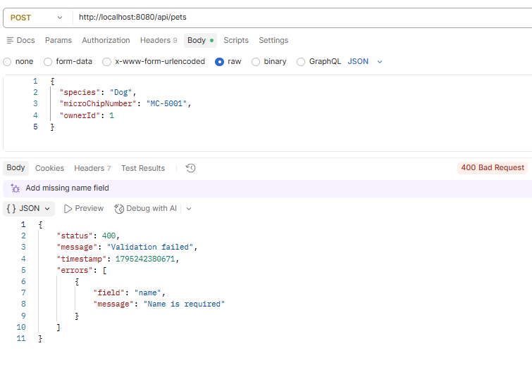

---

## Task 2 — Global Exception Handler

**Files created:**

- `GlobalExceptionHandler.java`: [src/main/java/com/clinic/exception/GlobalExceptionHandler.java](src/main/java/com/clinic/exception/GlobalExceptionHandler.java)
- `ErrorResponse.java`: [src/main/java/com/clinic/exception/ErrorResponse.java](src/main/java/com/clinic/exception/ErrorResponse.java)
- `ResourceNotFoundException.java`: [src/main/java/com/clinic/exception/ResourceNotFoundException.java](src/main/java/com/clinic/exception/ResourceNotFoundException.java)

**Evidence — 404 response:**

> Response body for `GET http://localhost:8080/api/pets/999` (non-existent ID):

```json
{
    "status": 404,
    "message": "Pet not found with id: 999",
    "timestamp": 1795242268744,
    "errors": null
}
```

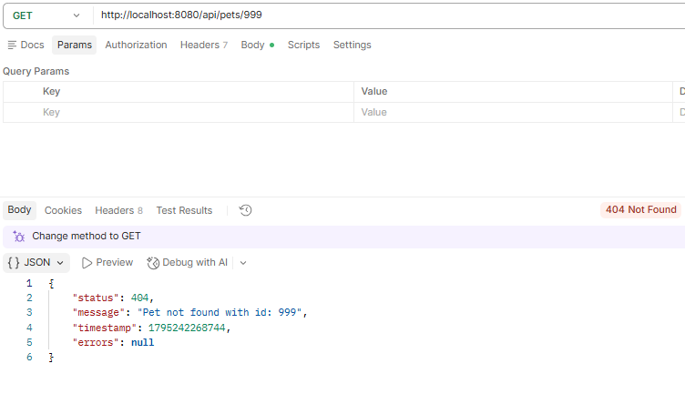

**Evidence — 400 response with field errors:**

> Response body for `POST http://localhost:8080/api/pets` with the invalid body `{ "name": "", "species": "", "microChipNumber": "", "ownerId": null, "contactEmail": "not-an-email" }`, showing the populated `errors` array:

```json
{
    "status": 400,
    "message": "Validation failed",
    "timestamp": 1795243539386,
    "errors": [
        {
            "field": "contactEmail",
            "message": "Invalid email format"
        },
        {
            "field": "microChipNumber",
            "message": "Microchip number is required"
        },
        {
            "field": "name",
            "message": "Name is required"
        },
        {
            "field": "ownerId",
            "message": "Owner id is required"
        },
        {
            "field": "name",
            "message": "Name must be between 2 and 100 characters"
        },
        {
            "field": "species",
            "message": "Species is required"
        }
    ]
}
```

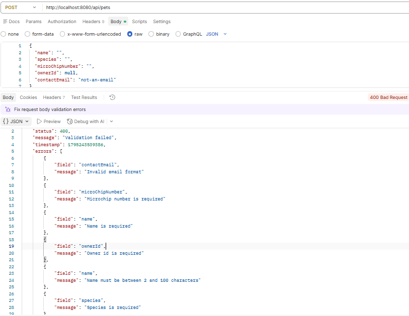

---

## Task 3 — CORS Configuration

**File created:**

- `WebConfig.java`: [src/main/java/com/clinic/config/WebConfig.java](src/main/java/com/clinic/config/WebConfig.java)

**Evidence — CORS headers present:**

> curl output for the preflight (OPTIONS) request. The response includes `Access-Control-Allow-Origin: http://localhost:3000`:

```
PS> curl.exe -v -X OPTIONS http://localhost:8080/api/pets -H "Origin: http://localhost:3000" -H "Access-Control-Request-Method: POST"

> OPTIONS /api/pets HTTP/1.1
> Host: localhost:8080
> Origin: http://localhost:3000
> Access-Control-Request-Method: POST

< HTTP/1.1 200
< Vary: Origin
< Vary: Access-Control-Request-Method
< Vary: Access-Control-Request-Headers
< Access-Control-Allow-Origin: http://localhost:3000
< Access-Control-Allow-Methods: GET,POST,PUT,PATCH,DELETE,OPTIONS
< Access-Control-Allow-Credentials: true
< Allow: GET, HEAD, POST, PUT, DELETE, OPTIONS, PATCH
< Access-Control-Max-Age: 1800
< Content-Length: 0
< Date: Sat, 21 Nov 2026 06:30:34 GMT
```

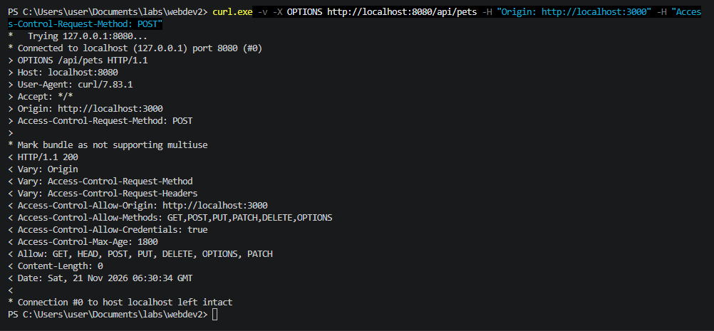

---

## Task 4 — Pagination and Filtering

**Files updated:**

- Repository method added: [PetRepository.java](src/main/java/com/clinic/repository/PetRepository.java) — `Page<Pet> findBySpeciesIgnoreCase(String species, Pageable pageable)`
- Service method updated: [PetService.java](src/main/java/com/clinic/service/PetService.java) — `findAll(...)` builds the `Pageable`/`Sort` and returns `Page<PetDTO>`
- Controller method updated: [PetController.java](src/main/java/com/clinic/controller/PetController.java) — `GET /api/pets` with `page`, `size`, `sort`, `direction`, `species`; size capped at 100

**Evidence — paginated response:**

> Response for `GET http://localhost:8080/api/pets?page=0&size=5&sort=name,asc` (6 pets in total, so page 0 has 5 and there are 2 pages):

```json
{
    "content": [
        { "id": 7, "name": "Bella", "species": "Rabbit", "microChipNumber": "MC-1006", "ownerId": 2, "contactEmail": null },
        { "id": 2, "name": "Buddy", "species": "Dog", "microChipNumber": "MC-1001", "ownerId": 2, "contactEmail": null },
        { "id": 3, "name": "Luna", "species": "Cat", "microChipNumber": "MC-1002", "ownerId": 2, "contactEmail": null },
        { "id": 4, "name": "Max", "species": "Dog", "microChipNumber": "MC-1003", "ownerId": 2, "contactEmail": null },
        { "id": 5, "name": "Milo", "species": "Cat", "microChipNumber": "MC-1004", "ownerId": 2, "contactEmail": null }
    ],
    "empty": false,
    "first": true,
    "last": false,
    "number": 0,
    "numberOfElements": 5,
    "pageable": {
        "offset": 0,
        "pageNumber": 0,
        "pageSize": 5,
        "paged": true,
        "sort": { "empty": false, "sorted": true, "unsorted": false },
        "unpaged": false
    },
    "size": 5,
    "sort": { "empty": false, "sorted": true, "unsorted": false },
    "totalElements": 6,
    "totalPages": 2
}
```

The `content` array is sorted alphabetically by `name` (Bella, Buddy, Luna, Max, Milo).

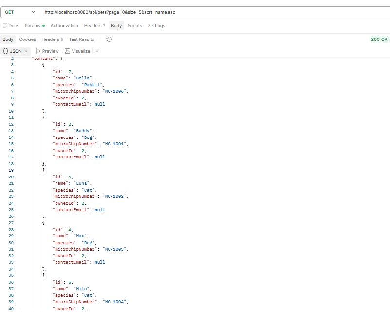
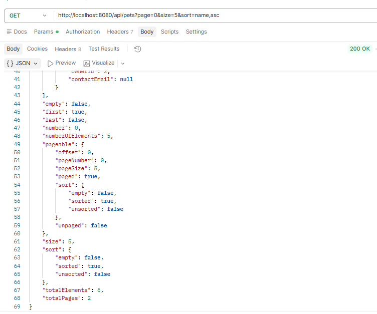

**Evidence — filtered response:**

> Response for `GET http://localhost:8080/api/pets?species=Dog` — every pet in `content` has `"species": "Dog"`:

```json
{
    "content": [
        { "id": 2, "name": "Buddy", "species": "Dog", "microChipNumber": "MC-1001", "ownerId": 2, "contactEmail": null },
        { "id": 4, "name": "Max", "species": "Dog", "microChipNumber": "MC-1003", "ownerId": 2, "contactEmail": null },
        { "id": 6, "name": "Rocky", "species": "Dog", "microChipNumber": "MC-1005", "ownerId": 2, "contactEmail": null }
    ],
    "empty": false,
    "first": true,
    "last": true,
    "number": 0,
    "numberOfElements": 3,
    "pageable": {
        "offset": 0,
        "pageNumber": 0,
        "pageSize": 20,
        "paged": true,
        "sort": { "empty": false, "sorted": true, "unsorted": false },
        "unpaged": false
    },
    "size": 20,
    "sort": { "empty": false, "sorted": true, "unsorted": false },
    "totalElements": 3,
    "totalPages": 1
}
```

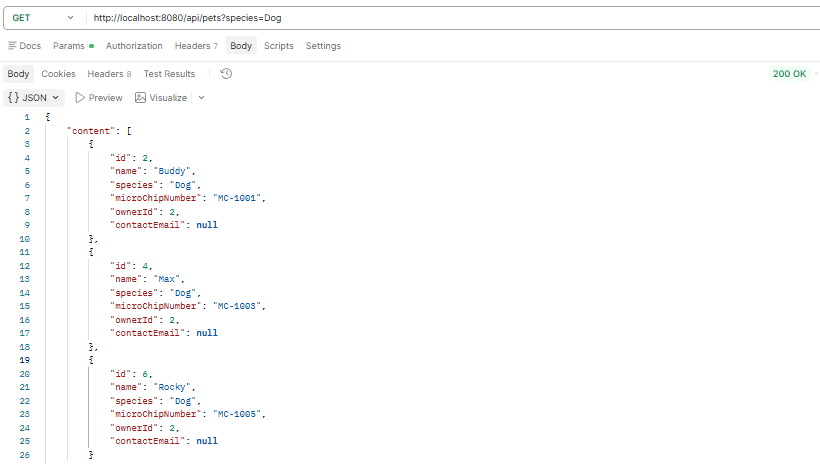
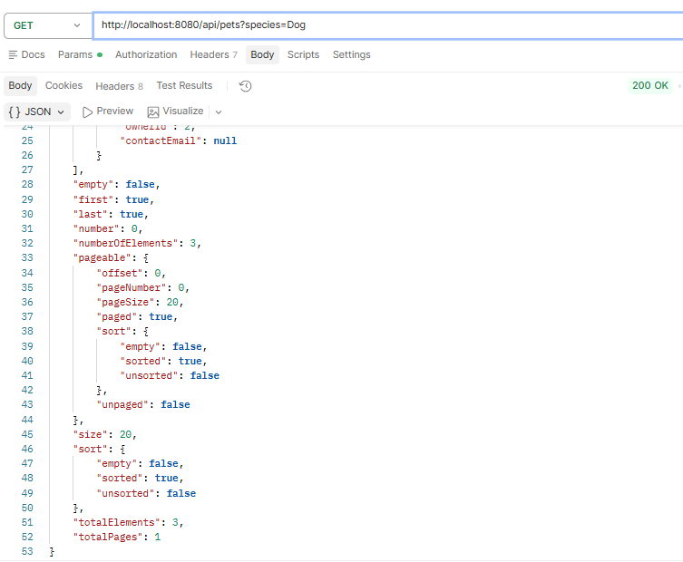

**Evidence — max size cap:**

> What response did you get when you requested `?size=999`? What was the actual page size in the metadata?

`GET http://localhost:8080/api/pets?size=999` returned **200 OK**. The controller caps the size with `Math.min(Math.max(size, 1), 100)`, so the metadata shows `"size": 100` and `"pageable.pageSize": 100`, not 999. (The database only has 6 pets, so `numberOfElements` and `totalElements` are 6 and `totalPages` is 1.)

```
"numberOfElements": 6,
"pageable": { "pageNumber": 0, "pageSize": 100, ... },
"size": 100,
"totalElements": 6,
"totalPages": 1
```

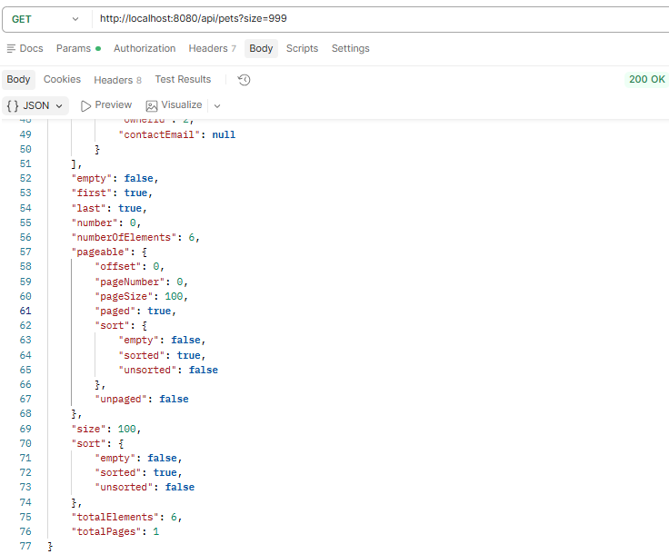

---

## Task 5 — Documentation and Test Collection

**Files committed:**

- `API.md` location in repo: [API.md](API.md)
- `api_tests.json` location in repo: [api_tests.json](api_tests.json)

**Test collection run evidence:**

> Postman Collection Runner, collection **Week11 - Stephanie Mhay de Leon API**, 1 iteration:

```
14 requests run | 30 tests | 30 passed | 0 failed | 0 errors
Duration: 2s 146ms | Avg. response time: 21 ms
```

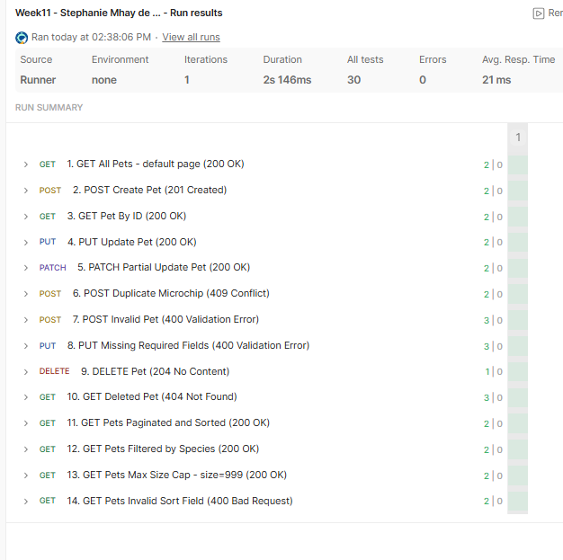
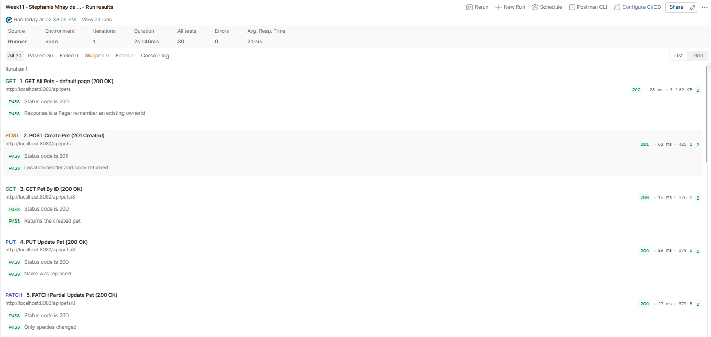
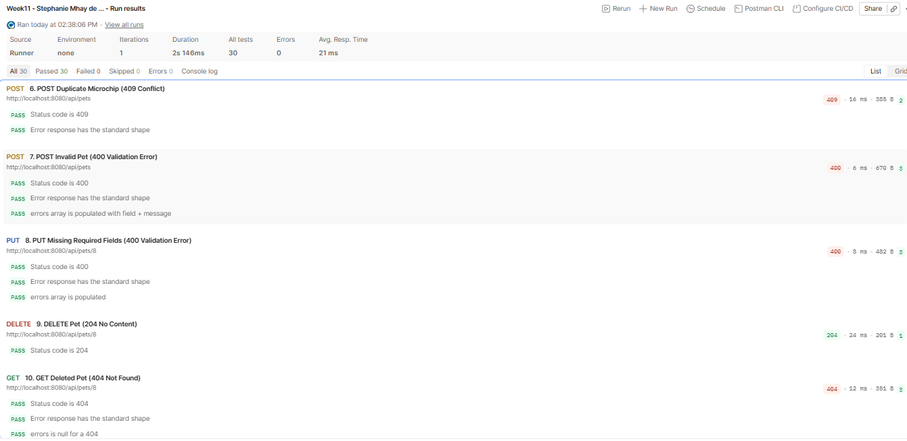
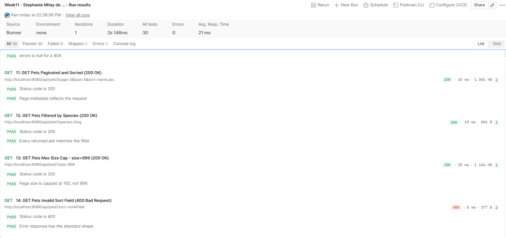

**List the requests in your collection:**

| Request name | Method | Path | Expected status | Tests passed |
|---|---|---|---|---|
| 1. GET All Pets (default page) | GET | `/api/pets` | 200 OK | 2 / 2 |
| 2. POST Create Pet | POST | `/api/pets` | 201 Created | 2 / 2 |
| 3. GET Pet By ID | GET | `/api/pets/{{petId}}` | 200 OK | 2 / 2 |
| 4. PUT Update Pet | PUT | `/api/pets/{{petId}}` | 200 OK | 2 / 2 |
| 5. PATCH Partial Update Pet | PATCH | `/api/pets/{{petId}}` | 200 OK | 2 / 2 |
| 6. POST Duplicate Microchip | POST | `/api/pets` | 409 Conflict | 2 / 2 |
| 7. POST Invalid Pet | POST | `/api/pets` | 400 (errors array) | 3 / 3 |
| 8. PUT Missing Required Fields | PUT | `/api/pets/{{petId}}` | 400 (errors array) | 3 / 3 |
| 9. DELETE Pet | DELETE | `/api/pets/{{petId}}` | 204 No Content | 1 / 1 |
| 10. GET Deleted Pet | GET | `/api/pets/{{petId}}` | 404 Not Found | 3 / 3 |
| 11. GET Paginated and Sorted | GET | `/api/pets?page=0&size=5&sort=name,asc` | 200 OK | 2 / 2 |
| 12. GET Filtered by Species | GET | `/api/pets?species=Dog` | 200 OK | 2 / 2 |
| 13. GET Max Size Cap | GET | `/api/pets?size=999` | 200 OK (size = 100) | 2 / 2 |
| 14. GET Invalid Sort Field | GET | `/api/pets?sort=notAField` | 400 Bad Request | 2 / 2 |

---

## Reflection

> In 2–3 sentences: which of the five topics from Week 11 had the biggest impact on your capstone API? What surprised you most when implementing it?

The topic with the biggest impact on my capstone API was global exception handling: every error (validation, not found, duplicate microchip, invalid sort field) now comes back in the same `{ status, message, timestamp, errors }` shape from one `@RestControllerAdvice` class, so a client always knows what to expect. What surprised me most was how much `@Valid` does in one request: a single invalid POST returned all six field errors at once, including two different errors on the `name` field. I also learned that PUT and PATCH need separate DTOs, because every PATCH field is optional but must still be valid when it is sent.

---

## Finals - Week 13 (F1)

- Lecture notes: [docs/week13/lecture.md](docs/week13/lecture.md)
- Checkpoint: [docs/week13/checkpoint.md](docs/week13/checkpoint.md)
- Evidence: [docs/week13/evidence/](docs/week13/evidence/)
