# WEBDEV2 — Week 10 Lab Answers

Name: Stephanie Mhay D. De Leon

Student ID: 2510576

GitHub repo: https://github.com/stepanotchie/webdev2

Date submitted: 18 November 2026

---

## Task 1 — URL Design & Controller Skeleton

**URL design table (method, path, expected status codes):**

| HTTP Method | URL Path | Expected Status Codes |
|---|---|---|
| GET | `/api/pets` | `200` |
| GET | `/api/pets/{id}` | `200`, `404` |
| POST | `/api/pets` | `201`, `400`, `409` |
| PUT | `/api/pets/{id}` | `200`, `400`, `404`, `409` |
| PATCH | `/api/pets/{id}` | `200`, `404`, `409` |
| DELETE | `/api/pets/{id}` | `204`, `404` |

**Controller skeleton code:**
```java
package com;

import java.util.List;
import org.springframework.http.ResponseEntity;
import org.springframework.web.bind.annotation.*;

@RestController
@RequestMapping("/api/pets")
public class PetController {

    @GetMapping
    public List<PetDTO> getAllPets() {
        return null;
    }

    @GetMapping("/{id}")
    public ResponseEntity<PetDTO> getPetById(@PathVariable Long id) {
        return null;
    }

    @PostMapping
    public ResponseEntity<PetDTO> create(@RequestBody CreatePetRequest request) {
        return null;
    }

    @PutMapping("/{id}")
    public ResponseEntity<PetDTO> update(@PathVariable Long id, @RequestBody UpdatePetRequest request) {
        return null;
    }

    @PatchMapping("/{id}")
    public ResponseEntity<PetDTO> patch(@PathVariable Long id, @RequestBody UpdatePetRequest request) {
        return null;
    }

    @DeleteMapping("/{id}")
    public ResponseEntity<Void> delete(@PathVariable Long id) {
        return null;
    }
}
```

**Evidence (screenshot filename or curl output):**

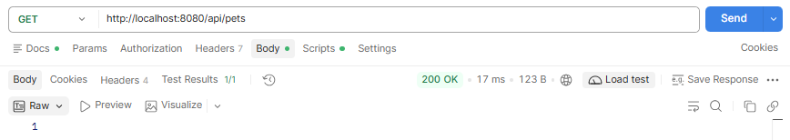

`GET /api/pets` on the stub controller responds with `200 OK` and an empty body.

**Reflection question:**
_Why do REST URLs use plural nouns (`/api/students`) rather than verb phrases (`/api/getStudents`), and what role does the HTTP method play?_

Answer:
A URL identifies a resource, which is a thing, so it is named with a plural noun for the collection and a path variable for one member. The HTTP method is the verb that says what to do with that resource: GET reads, POST creates, PUT replaces, PATCH partially updates, and DELETE removes. Putting the verb in the URL (`/api/getStudents`) duplicates what HTTP already provides and creates a different URL for every action, so clients must read documentation instead of guessing the standard six endpoints.

---

## Task 2 — GET Endpoints — List & Get by ID

**Approach / explanation:**
`GET /api/pets` calls `petService.findAll()` and returns a `List<PetDTO>`, so an empty table gives `200 []`. `GET /api/pets/{id}` calls `petService.findById(id)`, which returns an `Optional<PetDTO>`, and the controller turns it into `200` with `.map(ResponseEntity::ok)` or `404` with `.orElse(ResponseEntity.notFound().build())`. `PetDTO` exposes only `id`, `name`, `species`, `microChipNumber`, and `ownerId`; the `owner` (`AppUser`) and `vaccinationRecords` relationships of the `Pet` entity never leave the service layer.

**`PetDTO` class code:**
```java
package com;

public class PetDTO {
    private Long id;
    private String name;
    private String species;
    private String microChipNumber;
    private Long ownerId;

    public PetDTO() {
    }

    public PetDTO(Long id, String name, String species, String microChipNumber, Long ownerId) {
        this.id = id;
        this.name = name;
        this.species = species;
        this.microChipNumber = microChipNumber;
        this.ownerId = ownerId;
    }

    public Long getId() {
        return id;
    }

    public void setId(Long id) {
        this.id = id;
    }

    public String getName() {
        return name;
    }

    public void setName(String name) {
        this.name = name;
    }

    public String getSpecies() {
        return species;
    }

    public void setSpecies(String species) {
        this.species = species;
    }

    public String getMicroChipNumber() {
        return microChipNumber;
    }

    public void setMicroChipNumber(String microChipNumber) {
        this.microChipNumber = microChipNumber;
    }

    public Long getOwnerId() {
        return ownerId;
    }

    public void setOwnerId(Long ownerId) {
        this.ownerId = ownerId;
    }
}
```

**`toDTO()` mapping method code:**
```java
public PetDTO toDTO(Pet pet) {
    return new PetDTO(
            pet.getId(),
            pet.getName(),
            pet.getSpecies(),
            pet.getMicroChipNumber(),
            pet.getOwner().getId());
}
```

**Evidence (screenshot filename or curl/Postman output):**

GET all: `200 [...]`

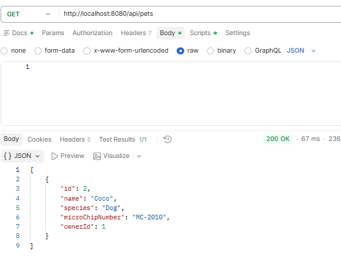

GET by existing ID: `200`

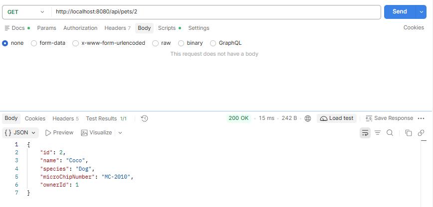

GET by non-existent ID: `404`

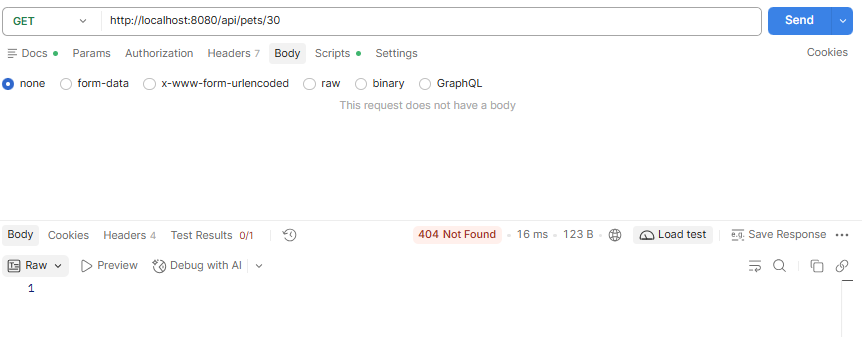

When the table is empty, `findAll()` returns an empty list, so the endpoint returns `200 []` rather than `404`.

**Reflection question:**
_What would go wrong if you returned the JPA entity directly from `@GetMapping("/{id}")` instead of a DTO?_

Answer:
Returning the `Pet` entity would expose its `owner` and `vaccinationRecords` associations to every client. Those are lazy relationships, so Jackson would hit them after the JPA session has closed (`spring.jpa.open-in-view=false` in this project) and throw a `LazyInitializationException`, or recurse forever through the bidirectional `AppUser`, `Pet`, and `VaccinationRecord` links. It would also tie the public JSON contract to the database model, so renaming a field would silently break every client.

---

## Task 3 — POST Endpoint — Create with 201 + Location

**Approach / explanation:**
`CreatePetRequest` contains only `name`, `species`, `microChipNumber`, and `ownerId`, with no `id`, and uses `@NotBlank` and `@NotNull` so missing input returns `400`. The controller accepts it with `@Valid @RequestBody`, calls `petService.create(request)`, and builds the `Location` header with `ServletUriComponentsBuilder.fromCurrentRequest().path("/{id}")`. The service loads the owner (an unknown `ownerId` returns `400`), checks the unique microchip rule (`409`), maps the request DTO to a `Pet` entity attached to its owner with `owner.addPet(pet)`, saves it through `petRepository.save(pet)`, and returns the saved entity mapped to a `PetDTO`.

**`CreatePetRequest` class code:**
```java
package com;

import jakarta.validation.constraints.NotBlank;
import jakarta.validation.constraints.NotNull;

public class CreatePetRequest {
    @NotBlank
    private String name;

    @NotBlank
    private String species;

    @NotBlank
    private String microChipNumber;

    @NotNull
    private Long ownerId;

    public CreatePetRequest() {
    }

    public CreatePetRequest(String name, String species, String microChipNumber, Long ownerId) {
        this.name = name;
        this.species = species;
        this.microChipNumber = microChipNumber;
        this.ownerId = ownerId;
    }

    public String getName() {
        return name;
    }

    public void setName(String name) {
        this.name = name;
    }

    public String getSpecies() {
        return species;
    }

    public void setSpecies(String species) {
        this.species = species;
    }

    public String getMicroChipNumber() {
        return microChipNumber;
    }

    public void setMicroChipNumber(String microChipNumber) {
        this.microChipNumber = microChipNumber;
    }

    public Long getOwnerId() {
        return ownerId;
    }

    public void setOwnerId(Long ownerId) {
        this.ownerId = ownerId;
    }
}
```

**Controller `create()` method code:**
```java
@PostMapping
public ResponseEntity<PetDTO> create(@Valid @RequestBody CreatePetRequest request) {
    PetDTO created = petService.create(request);
    URI location = ServletUriComponentsBuilder.fromCurrentRequest()
            .path("/{id}")
            .buildAndExpand(created.getId())
            .toUri();
    return ResponseEntity.created(location).body(created);
}
```

**Evidence (screenshot filename or curl/Postman output):**

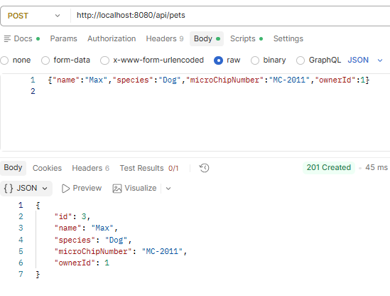

Response headers showing `Location: http://localhost:8080/api/pets/3`:

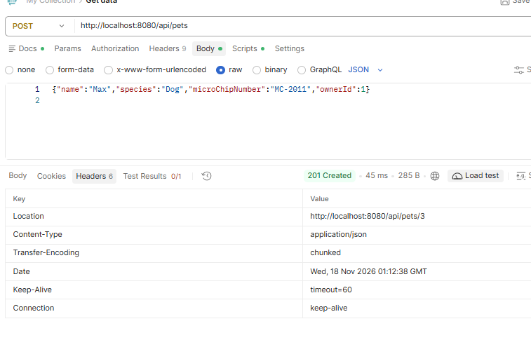

**Reflection question:**
_Why does the REST contract specify `201 Created` for a successful POST rather than `200 OK`, and why is the `Location` header useful to include?_

Answer:
`200 OK` only says a request succeeded, while `201 Created` says a new resource now exists, and clients, HTTP caches, and monitoring tools treat the two differently. The `Location` header tells the client the exact URL of the new resource, so it can fetch it immediately without guessing or searching for the generated ID, at no extra cost.

---

## Task 4 — PUT, PATCH & DELETE

**Approach / explanation:**
`update()` handles PUT as a full replacement: it loads the pet and overwrites `name`, `species`, `microChipNumber`, and the owner from the request, and `@Valid` rejects a PUT that omits a required field. `patch()` loads the pet and overwrites a field only when the incoming value is non-null, so unmentioned fields stay untouched. `delete()` returns `false` when the ID does not exist, which the controller maps to `404`, so deleting the same ID twice returns `204` and then `404` with no exception.

**`UpdatePetRequest` class code:**
```java
package com;

import jakarta.validation.constraints.NotBlank;
import jakarta.validation.constraints.NotNull;

public class UpdatePetRequest {
    @NotBlank
    private String name;

    @NotBlank
    private String species;

    @NotBlank
    private String microChipNumber;

    @NotNull
    private Long ownerId;

    public UpdatePetRequest() {
    }

    public UpdatePetRequest(String name, String species, String microChipNumber, Long ownerId) {
        this.name = name;
        this.species = species;
        this.microChipNumber = microChipNumber;
        this.ownerId = ownerId;
    }

    public String getName() {
        return name;
    }

    public void setName(String name) {
        this.name = name;
    }

    public String getSpecies() {
        return species;
    }

    public void setSpecies(String species) {
        this.species = species;
    }

    public String getMicroChipNumber() {
        return microChipNumber;
    }

    public void setMicroChipNumber(String microChipNumber) {
        this.microChipNumber = microChipNumber;
    }

    public Long getOwnerId() {
        return ownerId;
    }

    public void setOwnerId(Long ownerId) {
        this.ownerId = ownerId;
    }
}
```

**Controller code for PUT, PATCH, DELETE:**
```java
@PutMapping("/{id}")
public ResponseEntity<PetDTO> update(@PathVariable Long id, @Valid @RequestBody UpdatePetRequest request) {
    return petService.update(id, request)
            .map(ResponseEntity::ok)
            .orElse(ResponseEntity.notFound().build());
}

@PatchMapping("/{id}")
public ResponseEntity<PetDTO> patch(@PathVariable Long id, @RequestBody UpdatePetRequest request) {
    return petService.patch(id, request)
            .map(ResponseEntity::ok)
            .orElse(ResponseEntity.notFound().build());
}

@DeleteMapping("/{id}")
public ResponseEntity<Void> delete(@PathVariable Long id) {
    if (!petService.delete(id)) {
        return ResponseEntity.notFound().build();
    }
    return ResponseEntity.noContent().build();
}
```

**Evidence (screenshot filename or curl/Postman output):**

PUT `200`:

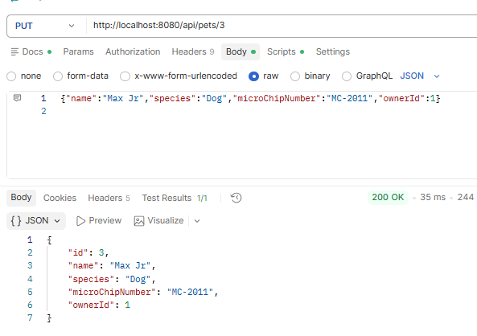

PATCH `200` (only `species` changed):

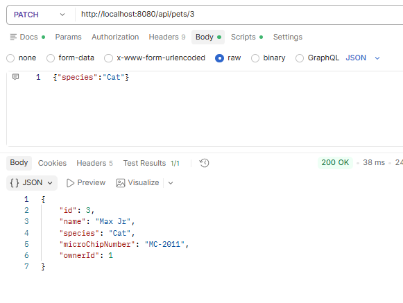

DELETE `204`:

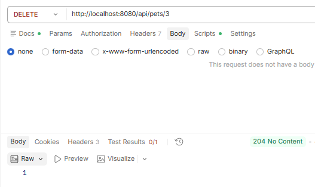

Second DELETE `404`:

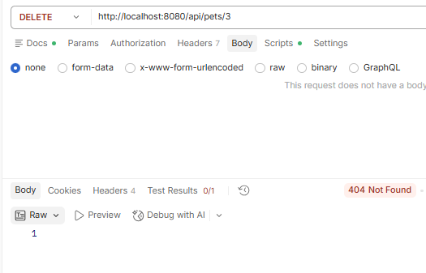

**Reflection question:**
_What is the difference between `PUT` and `PATCH` in terms of what the client sends, and what must the service-layer `patch()` method do differently from `update()`?_

Answer:
With PUT the client sends the complete new representation of the resource, so every field is replaced and omitted fields become blank or null. With PATCH the client sends only the fields to change. The `update()` method overwrites every field unconditionally, while `patch()` must check each incoming field and apply only the non-null ones, leaving the rest of the stored entity unchanged.

---

## Task 5 — Full DTO Layer Audit + Capstone Milestone 3

**DTO class list (names only — confirm no entity class names appear):**
- `CreatePetRequest`
- `UpdatePetRequest`
- `PetDTO`

**409 Conflict scenario:**
The business rule is that every pet must have a unique microchip number. `PetService.create()` checks `existsByMicroChipNumber` (and `update()`/`patch()` check `existsByMicroChipNumberAndIdNot`) and throws `DuplicateResourceException`, which the controller maps to `409 Conflict`.

Request:
```http
POST /api/pets
Content-Type: application/json

{"name":"Coco","species":"Dog","microChipNumber":"MC-2010","ownerId":1}
```

Response:
```http
HTTP/1.1 409 Conflict
Content-Type: application/json

{"message":"A pet with microchip number MC-2010 already exists"}
```

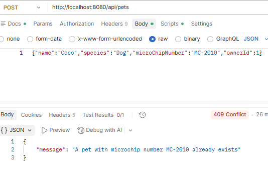

**Capstone Milestone 3 smoke-check evidence:**

`Week10SmokeRunner` (a `CommandLineRunner`) calls the running API over HTTP at startup, prints each status code, and stops with an error if any check fails. The console output below covers all six steps, plus the `409` and the second `DELETE`:

- [x] `POST` → `201`
- [x] `GET /{new-id}` → `200`
- [x] `PUT /{id}` → `200`
- [x] `PATCH /{id}` → `200` (other fields unchanged)
- [x] `DELETE /{id}` → `204`
- [x] `GET /{deleted-id}` → `404`

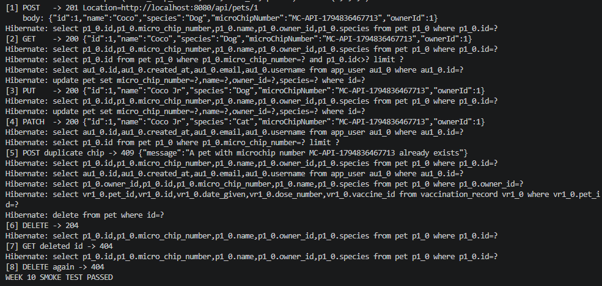

**Reflection question:**
_For one endpoint in your capstone API, state: the method, the URL, what status code it returns on success, what status code it returns when the resource is not found, and why there is no JPA entity in the controller method signature._

Answer:
The endpoint is `PUT /api/pets/{id}`. It returns `200 OK` with the updated `PetDTO` on success and `404 Not Found` when no pet has that ID. The method signature uses only `UpdatePetRequest` and `PetDTO` because entities stay in the service layer: this keeps the lazy `owner` and `vaccinationRecords` relationships from being serialized, avoids lazy-loading errors, and keeps the API contract independent of the database model.

---

## Self-Check

- [x] All Week 10 work on the `week10` branch (project at branch root, no `week10/` folder)
- [x] This file completed and renamed `answers.md`
- [x] No JPA entity class appears in any controller method signature
- [x] Repository link pasted into Moodle (no files uploaded)