# WEBDEV2 — Week 9 Lab Answers

Name: Stephanie Mhay D. De Leon
Student ID: 2510576
GitHub repo: https://github.com/stepanotchie/webdev2 (branch `week9`)

> Evidence is from DemoRunner output (TASK 1 … TASK 5). (`DemoRunner` prints sections `TASK 1` … `TASK 5`). Entity code is in `src/main/java/com/week9/activity/`.

---

## Task 1 — One-to-One + One-to-Many Mappings

**Approach / explanation:**
`User` owns the 1:1 (`@OneToOne` + `@JoinColumn(name = "profile_id")`) and `UserProfile` is the inverse side with `mappedBy = "profile"`. `Employee` owns the 1:N because the many side holds the foreign key (`@ManyToOne(fetch = LAZY)` + `@JoinColumn(name = "department_id", nullable = false)`), and `Department` mirrors it with `@OneToMany(mappedBy = "department", cascade = ALL, orphanRemoval = true)`. The helper methods `Department.addEmployee()/removeEmployee()` and `User.setProfile()` update both sides keeps both sides in sync. In Task 4 the `Department.employees` cascade is narrowed to `{PERSIST, MERGE}` (final code below).

**Code / endpoint(s) used (if applicable):**
```java
@Entity @Table(name = "users")           // "user" is a reserved word in H2, so the table is "users"
public class User {
    @Id @GeneratedValue(strategy = GenerationType.IDENTITY) private Long id;
    private String username;

    @OneToOne(fetch = FetchType.LAZY, cascade = CascadeType.ALL, orphanRemoval = true)   // OWNING side
    @JoinColumn(name = "profile_id", unique = true)
    private UserProfile profile;

    public void setProfile(UserProfile profile) {            // keeps both sides in sync
        if (this.profile != null) this.profile.setUser(null);
        this.profile = profile;
        if (profile != null) profile.setUser(this);
    }
}

@Entity
public class UserProfile {
    @Id @GeneratedValue(strategy = GenerationType.IDENTITY) private Long id;
    private String bio;
    @OneToOne(mappedBy = "profile")                           // INVERSE side: Java field name, not a column
    private User user;
}

@Entity
public class Department {
    @Id @GeneratedValue(strategy = GenerationType.IDENTITY) private Long id;
    private String name;

    @OneToMany(mappedBy = "department", cascade = { CascadeType.PERSIST, CascadeType.MERGE },
               orphanRemoval = true, fetch = FetchType.LAZY)  // INVERSE side
    private List<Employee> employees = new ArrayList<>();

    public void addEmployee(Employee e)    { employees.add(e);    e.setDepartment(this); }
    public void removeEmployee(Employee e) { employees.remove(e); e.setDepartment(null); }
}

@Entity
public class Employee {
    @Id @GeneratedValue(strategy = GenerationType.IDENTITY) private Long id;
    private String name;

    @ManyToOne(fetch = FetchType.LAZY, optional = false)      // OWNING side: writes the FK
    @JoinColumn(name = "department_id", nullable = false)
    private Department department;
}

// DemoRunner: ONE save persists the department and all three employees; findAll() reads them back
Department eng = new Department("Engineering");
eng.addEmployee(new Employee("Maryx")); eng.addEmployee(new Employee("Eli")); eng.addEmployee(new Employee("Hannah"));
departmentRepository.save(eng);
tx.executeWithoutResult(s -> departmentRepository.findAll().forEach(d -> System.out.println(d.getName() + " -> " + names(d.getEmployees()))));
```

**Evidence (screenshot filename, request/response sample, or file reference in this folder):**
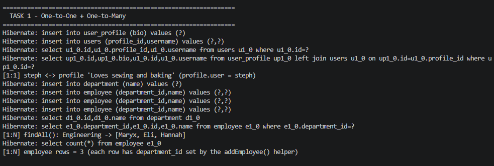

Console output of section `TASK 1` (the screenshot also shows the `insert into department` and three `insert into employee (... department_id ...)` SQL lines):
```
[1:1] steph <-> profile 'Loves sewing and baking' (profile.user = steph)
[1:N] findAll(): Engineering -> [Maryx, Eli, Hannah]
[1:N] employee rows = 3 (each row has department_id set by the addEmployee() helper)
```

**Reflection question:**
_Which entity owns the `Department`–`Employee` relationship and why, and what value must `mappedBy` contain?_

Your answer:
`Employee` owns the relationship. In a one-to-many pair the foreign key always lives on the many side (`employee.department_id`), and the owning side is the one that writes that column, so `Employee.department` carries `@ManyToOne` + `@JoinColumn`. `Department.employees` is only the read-only mirror. `mappedBy` must contain the **Java field name** on the owning entity, i.e. `mappedBy = "department"` (lowercase, the field in `Employee`), not the column name `department_id` and not the class name `Department`.

---

## Task 2 — Many-to-Many Join Table + Association Entity

**Approach / explanation:**
Step 1 was a plain `@ManyToMany` between `Student` (owning side, `@JoinTable(name = "student_course", ...)`) and `Course` (`mappedBy = "courses"`), shown in the first code block. I replaced it with the association entity `Enrollment` because the link needs `enrollmentDate` and `grade` and a rule against duplicates, none of which a hidden join table can hold. `Enrollment` has two `@ManyToOne` FKs (`student_id`, `course_id`) and `@UniqueConstraint(name = "uk_student_course", columnNames = {"student_id","course_id"})`; `Student` and `Course` now use `@OneToMany(mappedBy = ...)` toward it. `saveAndFlush()` forces the INSERT immediately so the duplicate is rejected right away.

**Code / endpoint(s) used (if applicable):**
```java
// ---- STEP 1: direct @ManyToMany (replaced in step 2) ----
@Entity public class Student {
    @ManyToMany
    @JoinTable(name = "student_course",
               joinColumns = @JoinColumn(name = "student_id"),
               inverseJoinColumns = @JoinColumn(name = "course_id"))   // OWNING side -> hidden table student_course
    private Set<Course> courses = new HashSet<>();
}
@Entity public class Course {
    @ManyToMany(mappedBy = "courses")                                  // INVERSE side: field name in Student
    private Set<Student> students = new HashSet<>();
}

// ---- STEP 2: association entity (final code) ----
@Entity
@Table(name = "enrollment",
       uniqueConstraints = @UniqueConstraint(name = "uk_student_course", columnNames = { "student_id", "course_id" }))
public class Enrollment {
    @Id @GeneratedValue(strategy = GenerationType.IDENTITY) private Long id;

    @ManyToOne(fetch = FetchType.LAZY, optional = false)
    @JoinColumn(name = "student_id", nullable = false) private Student student;

    @ManyToOne(fetch = FetchType.LAZY, optional = false)
    @JoinColumn(name = "course_id", nullable = false)  private Course course;

    private LocalDate enrollmentDate;
    private String grade;
}

@Entity public class Student {
    @OneToMany(mappedBy = "student", cascade = { CascadeType.PERSIST, CascadeType.MERGE }, orphanRemoval = true)
    private List<Enrollment> enrollments = new ArrayList<>();
}
@Entity public class Course {
    @OneToMany(mappedBy = "course")                     // shared entity: no cascade
    private List<Enrollment> enrollments = new ArrayList<>();
}

// DemoRunner
private Enrollment enroll(Long studentId, Long courseId, String grade) {
    return tx.execute(s -> {
        Student student = studentRepository.findById(studentId).orElseThrow();
        Course course = courseRepository.findById(courseId).orElseThrow();
        Enrollment e = student.enroll(course, LocalDate.now(), grade);   // wires both parents
        return enrollmentRepository.saveAndFlush(e);                     // INSERT now
    });
}
try { enroll(alice.getId(), webdev.getId(), "B"); }
catch (DataIntegrityViolationException ex) { System.out.println("DUPLICATE REJECTED ..."); }
```

**Evidence (screenshot filename, request/response sample, or file reference in this folder):**
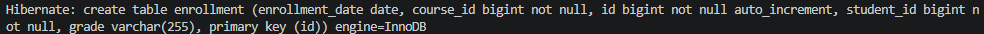
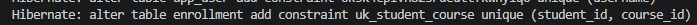
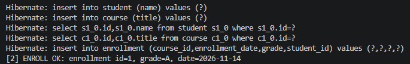
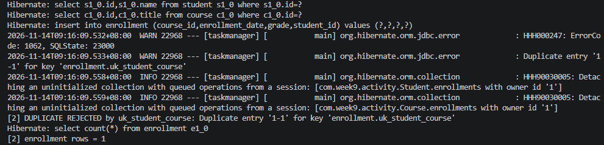

Console output of section `TASK 2`, plus the startup schema log lines from the same run (MySQL):
```
Hibernate: create table enrollment (enrollment_date date, course_id bigint not null, id bigint not null auto_increment, student_id bigint not null, grade varchar(255), primary key (id)) engine=InnoDB
Hibernate: alter table enrollment add constraint uk_student_course unique (student_id, course_id)
```
```
[2] ENROLL OK: enrollment id=1, grade=A, date=2026-11-14
[2] DUPLICATE REJECTED by uk_student_course: Duplicate entry '1-1' for key 'enrollment.uk_student_course'
[2] enrollment rows = 1
```

**Reflection question:**
_When must a many-to-many relationship be modeled as an association entity instead of a direct `@ManyToMany`, and what did the unique constraint protect in your test?_

Your answer:
A many-to-many must become an association entity as soon as the link itself carries data or rules: a grade, an enrollment date, a role, a quantity, a status, or a "no duplicates" rule. A direct `@ManyToMany` hides the join table, so there is no Java class or column to hold that data and nowhere to put constraints or custom queries. Modeling it as `Student 1—* Enrollment *—1 Course` makes the link a normal, queryable entity. In my test, `uk_student_course` on `(student_id, course_id)` rejected the second enrollment of Jan liam in WEBDEV2 with a `DataIntegrityViolationException`, and the enrollment row count stayed at 1, so the same student can never be enrolled twice in the same course.

---

## Task 3 — Fetch Strategies Experiment — LAZY vs EAGER

**Approach / explanation:**
Every association is `LAZY`. I reproduced the exception by loading an `Employee` through a service method that is **not** transactional (`EmployeeService.getEmployee`) and then calling `getDepartment().getName()` in the caller; `DemoRunner` is deliberately not `@Transactional` and `spring.jpa.open-in-view=false`, so the session is already closed. I fixed it two ways: (a) `@Transactional(readOnly = true)` on the service method, and (b) a fetch join query (`findByIdWithDepartment`). Hibernate statistics print how many SQL statements each variant ran. Blanket EAGER on collections is avoided because it loads data nobody asked for on every query and causes N+1 queries and huge joins.

**Code / endpoint(s) used (if applicable):**
```java
// Employee: @ManyToOne(fetch = FetchType.LAZY, optional = false) @JoinColumn(name = "department_id", nullable = false)

@Service
public class EmployeeService {
    // (A) NOT transactional: returns a detached Employee with an uninitialised Department proxy
    public Employee getEmployee(Long id) { return employeeRepository.findById(id).orElseThrow(); }

    // (B) Fix #1: one open session for the whole method
    @Transactional(readOnly = true)
    public String getDepartmentName(Long id) {
        return employeeRepository.findById(id).orElseThrow().getDepartment().getName();
    }

    // (C) Fix #2: fetch join
    public Employee getEmployeeWithDepartment(Long id) { return employeeRepository.findByIdWithDepartment(id).orElseThrow(); }
}

public interface EmployeeRepository extends JpaRepository<Employee, Long> {
    @Query("SELECT e FROM Employee e JOIN FETCH e.department WHERE e.id = :id")
    Optional<Employee> findByIdWithDepartment(@Param("id") Long id);
}

// Reproducing the failure (DemoRunner is NOT @Transactional)
Employee e = employeeService.getEmployee(employeeId);
System.out.println(e.getDepartment().getName());   // -> LazyInitializationException
```

**Evidence (screenshot filename, request/response sample, or file reference in this folder):**
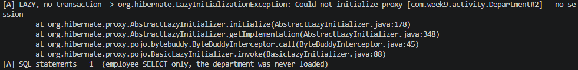
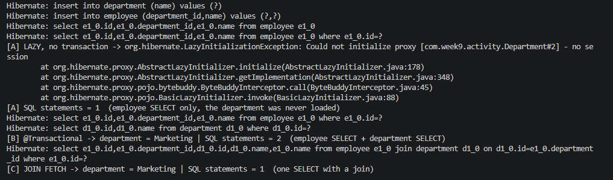

Console output of section `TASK 3` (stack trace excerpt and SQL statement counts):
```
[A] LAZY, no transaction -> org.hibernate.LazyInitializationException: Could not initialize proxy [com.week9.activity.Department#2] - no session
        at org.hibernate.proxy.AbstractLazyInitializer.initialize(AbstractLazyInitializer.java:178)
        at org.hibernate.proxy.AbstractLazyInitializer.getImplementation(AbstractLazyInitializer.java:348)
        at org.hibernate.proxy.pojo.bytebuddy.ByteBuddyInterceptor.call(ByteBuddyInterceptor.java:45)
        at org.hibernate.proxy.pojo.BasicLazyInitializer.invoke(BasicLazyInitializer.java:88)
[A] SQL statements = 1  (employee SELECT only, the department was never loaded)
[B] @Transactional -> department = Marketing | SQL statements = 2  (employee SELECT + department SELECT)
[C] JOIN FETCH -> department = Marketing | SQL statements = 1  (one SELECT with a join)
```

SQL log excerpts of the three variants (from the same run):
```
-- (A) lazy, no transaction: only the employee is selected, then the exception
Hibernate: select e1_0.id,e1_0.department_id,e1_0.name from employee e1_0 where e1_0.id=?

-- (B) @Transactional: two selects
Hibernate: select e1_0.id,e1_0.department_id,e1_0.name from employee e1_0 where e1_0.id=?
Hibernate: select d1_0.id,d1_0.name from department d1_0 where d1_0.id=?

-- (C) JOIN FETCH: one select with a join
Hibernate: select e1_0.id,e1_0.department_id,d1_0.id,d1_0.name,e1_0.name from employee e1_0 join department d1_0 on d1_0.id=e1_0.department_id where e1_0.id=?
```

| Variant | Result | SQL statements |
|---|---|---|
| (A) LAZY, no transaction | `LazyInitializationException` | 1 (employee only) |
| (B) `@Transactional(readOnly = true)` | works | 2 (employee, then department) |
| (C) `JOIN FETCH` | works, even outside a transaction | 1 (join) |

Observation: the exception appears because the department is only a proxy and the session that could load it has already closed. `@Transactional` fixes it but still needs a second round trip (and one more per row inside a loop), while the fetch join loads exactly what this use case needs in a single query without changing the global mapping. Switching the mapping to EAGER would also "fix" it, but it would pay that cost on every load, including where the department is not needed.

**Reflection question:**
_What causes `LazyInitializationException`, and why is prefer-LAZY plus explicit fetch join/`@EntityGraph` preferable to marking everything EAGER?_

Your answer:
`LazyInitializationException` is thrown when code touches a lazy association (an uninitialised proxy or collection) after the Hibernate session / persistence context has been closed, for example reading `employee.getDepartment().getName()` in a controller after the service transaction ended; Hibernate has no open session to run the deferred SELECT. Marking everything EAGER "fixes" it by loading related data on every query whether it is needed or not, which causes N+1 queries, large joins and wasted memory, and it cannot be turned off per use case. Keeping associations LAZY and fetching explicitly (`JOIN FETCH` or `@EntityGraph`, or `@Transactional` when the work really belongs in one transaction) loads exactly what each use case needs in a predictable number of queries.

---

## Task 4 — Cascade + orphanRemoval — Safe vs. Dangerous

**Approach / explanation:**
`Department → Employee` is composition (an employee has no meaning without its department), so `Department.employees` uses `cascade = {PERSIST, MERGE}` + `orphanRemoval = true`: saving a department saves new employees, and `removeEmployee(e)` + `save` deletes that employee row. `Student ↔ Course` is a shared path: `Student.enrollments` has `{PERSIST, MERGE}` + `orphanRemoval` (the enrollment rows are private link rows), while `Enrollment.course` and `Course.enrollments` have **no cascade**, and `CascadeType.REMOVE`/`ALL` is never used toward `Course`. Deleting one `Student` therefore deletes only that student's enrollments; the shared `Course` and the other student's enrollment survive.

**Code / endpoint(s) used (if applicable):**
```java
// (a) SAFE composition ------------------------------------------------------------
@Entity
public class Department {
    @OneToMany(mappedBy = "department",
               cascade = { CascadeType.PERSIST, CascadeType.MERGE },   // <-- no REMOVE / ALL
               orphanRemoval = true,                                   // <-- delete child removed from the list
               fetch = FetchType.LAZY)
    private List<Employee> employees = new ArrayList<>();
    public void removeEmployee(Employee e) { employees.remove(e); e.setDepartment(null); }
}
tx.executeWithoutResult(s -> {
    Department d = departmentRepository.findById(savedSupport.getId()).orElseThrow();
    Employee carlo = d.getEmployees().stream().filter(e -> "Carlo Valdez".equals(e.getName())).findFirst().orElseThrow();
    d.removeEmployee(carlo);
    departmentRepository.save(d);                                      // orphan row is deleted
});

// (b) SHARED entity: Student -> Enrollment -> Course -------------------------------
@Entity public class Student {
    @OneToMany(mappedBy = "student",
               cascade = { CascadeType.PERSIST, CascadeType.MERGE },   // <-- PERSIST/MERGE only
               orphanRemoval = true)                                   // enrollments are private link rows
    private List<Enrollment> enrollments = new ArrayList<>();
}
@Entity public class Course {
    @OneToMany(mappedBy = "course")                                    // <-- NO cascade: Course is shared
    private List<Enrollment> enrollments = new ArrayList<>();
}
// Enrollment: @ManyToOne student / @ManyToOne course -> NO cascade on either

tx.executeWithoutResult(s -> studentRepository.delete(studentRepository.findById(mary.getId()).orElseThrow()));

// What would be DANGEROUS (not used anywhere in the project):
// @ManyToMany(cascade = CascadeType.ALL) private Set<Course> courses;   // delete(student) would try to DELETE the shared course
```

**Evidence (screenshot filename, request/response sample, or file reference in this folder):**
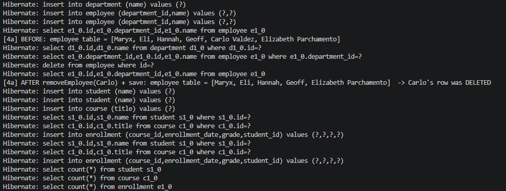
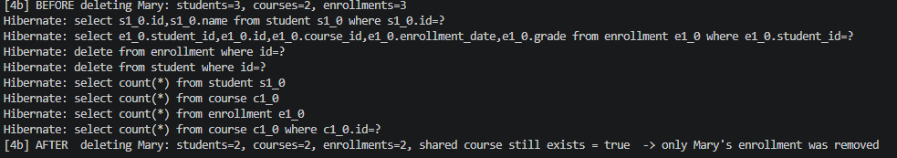

Console output of section `TASK 4` (before/after state read from the database):
```
[4a] BEFORE: employee table = [Maryx, Eli, Hannah, Geoff, Carlo Valdez, Elizabeth Parchamento]
[4a] AFTER removeEmployee(Carlo) + save: employee table = [Maryx, Eli, Hannah, Geoff, Elizabeth Parchamento]  -> Carlo's row was DELETED
[4b] BEFORE deleting Mary: students=3, courses=2, enrollments=3
[4b] AFTER  deleting Mary: students=2, courses=2, enrollments=2, shared course still exists = true  -> only Mary's enrollment was removed
```

**Reflection question:**
_What is the difference between `CascadeType.REMOVE` and `orphanRemoval = true`, and in which situation is each appropriate or dangerous?_

Your answer:
`CascadeType.REMOVE` propagates an explicit delete of the **parent** to its children (delete the department → delete its employees). `orphanRemoval = true` deletes a child row when it is merely **removed from the parent's collection** (the parent still exists), and it also deletes the children when the parent itself is deleted. Both are appropriate for private, owned children that cannot exist without the parent: order items, invoice lines, employees of a department, the enrollment link rows of a student. Both are dangerous on shared entities such as `Course`: with `REMOVE`/`ALL` on a Student→Course path, deleting one student would try to delete a course other students still use (data loss or a foreign-key error), and with `orphanRemoval` on a shared reference, detaching a course from one student would delete it for everyone. For shared paths I use only `PERSIST`/`MERGE` or no cascade at all.

---

## Task 5 — Capstone Milestone 2 — ERD to JPA Entity Model

**Approach / explanation:**
The capstone is the pet-care app from Milestone 1. Each noun became an entity with an `@Id`, and each relationship was decided from its cardinality: `AppUser 1—N Pet` (the many side `Pet` owns the FK `owner_id`, NOT NULL) and `Pet N—M Vaccine`, modeled as the association entity `VaccinationRecord` (owns FKs `pet_id` and `vaccine_id`, plus `dateGiven` and `doseNumber`, with a unique key on `(pet_id, vaccine_id, dose_number)`). Every association is `LAZY`, cascade is chosen per ownership (table below), each entity has a `JpaRepository`, and `DemoRunner` (Task 5 section) saves a small graph (1 user, 2 pets, 2 vaccines, 3 records), reads it back and proves the duplicate rejection.

**Code / endpoint(s) used (if applicable):**

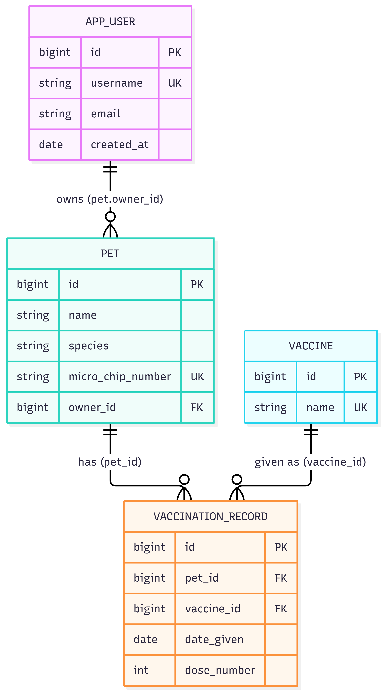

ERD → entity mapping:

| ERD element | JPA class / field | Cardinality | Owning side → FK / join table | Fetch | Cascade (one-line justification) |
|---|---|---|---|---|---|
| APP_USER | `AppUser` (`@Id id`) | — | — | — | — |
| PET | `Pet` (`@Id id`) | AppUser 1—N Pet | `Pet.owner` owns FK `pet.owner_id` (NOT NULL); `AppUser.pets` is `mappedBy = "owner"` | LAZY (a user screen rarely needs all pets) | `AppUser.pets`: PERSIST+MERGE, no REMOVE/orphan — a pet is a real record that can be re-homed |
| VACCINE | `Vaccine` (`@Id id`, unique `name`) | shared by many pets | no FK itself | LAZY | none — shared reference data |
| VACCINATION_RECORD | `VaccinationRecord` (`@Id id`) | Pet 1—N Record N—1 Vaccine = Pet N—M Vaccine | owns FKs `pet_id`, `vaccine_id`; `uk_pet_vaccine_dose(pet_id, vaccine_id, dose_number)` | LAZY | `Pet.vaccinationRecords`: PERSIST+MERGE+orphanRemoval — a record cannot exist without its pet; `Vaccine.records`: none |

```java
@Entity @Table(name = "app_user")
public class AppUser {
    @Id @GeneratedValue(strategy = GenerationType.IDENTITY) private Long id;
    @Column(nullable = false, unique = true) private String username;
    @OneToMany(mappedBy = "owner", cascade = { CascadeType.PERSIST, CascadeType.MERGE }, fetch = FetchType.LAZY)
    private List<Pet> pets = new ArrayList<>();
    public void addPet(Pet p) { pets.add(p); p.setOwner(this); }
}

@Entity
public class Pet {
    @ManyToOne(fetch = FetchType.LAZY, optional = false)
    @JoinColumn(name = "owner_id", nullable = false)                       // FK lives here
    private AppUser owner;

    @OneToMany(mappedBy = "pet", cascade = { CascadeType.PERSIST, CascadeType.MERGE }, orphanRemoval = true)
    private List<VaccinationRecord> vaccinationRecords = new ArrayList<>();
}

@Entity
@Table(name = "vaccination_record",
       uniqueConstraints = @UniqueConstraint(name = "uk_pet_vaccine_dose",
                                             columnNames = { "pet_id", "vaccine_id", "dose_number" }))
public class VaccinationRecord {
    @ManyToOne(fetch = FetchType.LAZY, optional = false) @JoinColumn(name = "pet_id", nullable = false)     private Pet pet;
    @ManyToOne(fetch = FetchType.LAZY, optional = false) @JoinColumn(name = "vaccine_id", nullable = false) private Vaccine vaccine;
    private LocalDate dateGiven;
    private int doseNumber;
}

@Entity public class Vaccine {
    @Column(nullable = false, unique = true) private String name;
    @OneToMany(mappedBy = "vaccine") private List<VaccinationRecord> records = new ArrayList<>();   // no cascade
}

// Repositories: AppUserRepository, PetRepository, VaccineRepository, VaccinationRecordRepository (all extend JpaRepository)

// Smoke test (DemoRunner.task5): ONE save(user) -> pets -> records, then read back in a transaction
appUserRepository.save(user);
AppUser u = appUserRepository.findById(id).orElseThrow();   // then walk u.getPets() and each pet's records
```

**Evidence (screenshot filename, request/response sample, or file reference in this folder):**

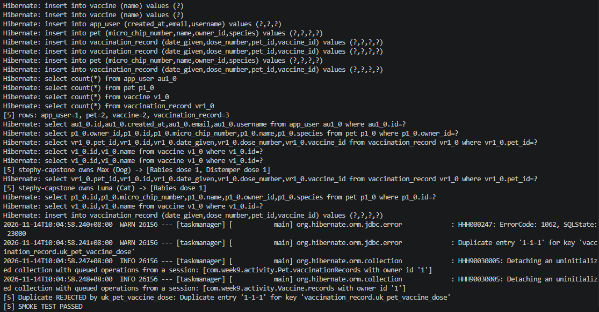

Console output of section `TASK 5` (passing run):
```
[5] rows: app_user=1, pet=2, vaccine=2, vaccination_record=3
[5] stephy-capstone owns Max (Dog) -> [Rabies dose 1, Distemper dose 1]
[5] stephy-capstone owns Luna (Cat) -> [Rabies dose 1]
[5] Duplicate REJECTED by uk_pet_vaccine_dose: Duplicate entry '1-1-1' for key 'vaccination_record.uk_pet_vaccine_dose'
[5] SMOKE TEST PASSED
```

**Reflection question:**
_For one relationship in your capstone model, state the cardinality, the owning side, where the FK/join table lives, and why you chose that fetch and cascade setting._

Your answer:
For `AppUser`–`Pet` the cardinality is one-to-many (one owner, many pets). The owning side is `Pet`, because the many side holds the foreign key: the column `owner_id` (NOT NULL) lives in the `pet` table via `@ManyToOne` + `@JoinColumn(name = "owner_id")`, and `AppUser.pets` is the inverse mirror with `mappedBy = "owner"` (the Java field name). I chose `LAZY` so loading a user does not pull in all of its pets; they are read inside a transaction when a use case needs them. For cascade I used only `PERSIST` and `MERGE` on `AppUser.pets` so saving a new user saves its new pets, but no `REMOVE` and no `orphanRemoval`, because a pet is an independent real-world record that can be transferred to another owner and must not be deleted just because it was detached or its owner was removed. The N:M `Pet`–`Vaccine` is the opposite case: its association entity `VaccinationRecord` is private to the pet, so `Pet.vaccinationRecords` uses `PERSIST`/`MERGE` + `orphanRemoval`, while the shared `Vaccine` has no cascade.

---

## Self-Check

- [x] All Week 9 work on the `week9` branch (project at branch root, no `week9/` folder)
- [x] This file completed and renamed `answers.md`
- [x] Repository link pasted into Moodle (no files uploaded)
