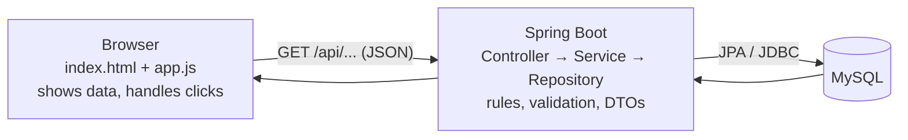

# Week 13 (F1) – Lecture Notes: My Connected Foundation

**Student:** Stephanie Mhay D. De Leon (2510576)

 **Repo:** https://github.com/stepanotchie/webdev2 
 
 **Branch:** `week13`

This week my Pet Clinic stopped being "an API I test in Postman" and became something I can open in a browser. Here is how I got there, what I learned, and what I still need to fix.

---
 
## 1. Where I started
 
I created `week13` from `week11`, as the handbook says. Before adding anything, I audited what I really had:
 
| Area | At the end of week 11 | What I did this week |
|---|---|---|
| Domain | Pet Clinic with four related tables: `app_user` (owner), `pet`, `vaccine`, `vaccination_record` | I kept it |
| Pet API | Full CRUD, DTOs, validation, error handler, paging, sorting, species filter | I kept it and did not change its behavior |
| Other resources | Only pets had endpoints | I added read endpoints for owners, vaccines, and a pet's vaccination history |
| Vaccine stock | No such column | I added `stock_doses`, because I need it for the week 14 workflow |
| Database setup | `ddl-auto=create` wiped my data on every start, and I had typed the DB password straight into `application.properties` | My SQL scripts now own the schema, Hibernate only checks it (`validate`), and my password lives in a git-ignored `.env` |
| Code layout | About 20 classes in one flat package, with old lab names | I split them into `controller`, `service`, `repository`, `model`, `dto`, `exception`, `config` |
| Startup runner | A leftover runner that wrote data every time the app started | I replaced it with an opt-in smoke test (`smoke` profile) that cleans up after itself |
| CORS | Hard-coded to `http://localhost:3000` | I now set it through `CORS_ALLOWED_ORIGINS` |
| Frontend | None | I built a plain HTML/CSS/JS page in `src/main/resources/static/` |
 
**What is still weak:** my app still connects to MySQL as `root` (I will fix that in week 15), I have no automated tests yet (week 16), and my old password is still in my git history (see section 9).
 
---
 
## 2. How my pieces fit
 

 
Each part has one job:
 
- **My browser code** draws the page and shows loading, empty, and error messages. It never talks to MySQL and holds no secrets.
- **My Spring Boot code** owns the rules and validation, and turns entities into DTOs.
- **My MySQL database** keeps the data and protects it with keys, UNIQUE, and CHECK constraints.
Following one click helped me understand it. When I press **Details** on Buddy, `showPet(1)` in `app.js` calls `getJson("/api/pets/1")`. That reaches `PetController`, then `PetService.findById`, then `PetRepository`, then the `pet` row in MySQL. The row comes back as a `PetDTO`, then as JSON, and my browser code writes it to the page with `textContent`.
 
---
 
## 3. My API contract
 
| Method and path | Parameters | Success | Errors |
|---|---|---|---|
| `GET /api/pets` | `page`, `size` (max 100), `sort`, `direction`, `species` | 200, a page; the records are in `content[]` | 400 bad sort, direction, or number |
| `GET /api/pets/{id}` | none | 200 `PetDTO` | 400 not a number, 404 not found |
| `GET /api/pets/{petId}/vaccinations` | none | 200 array (empty if none) | 404 unknown pet |
| `GET /api/owners`, `/api/owners/{id}` | `page`, `size` | 200 page or `OwnerDTO` | 400, 404 |
| `GET /api/vaccines`, `/api/vaccines/{id}` | `page`, `size` | 200 page or `VaccineDTO` | 400, 404 |
 
Every error from my API has the same shape: `{ "status": 404, "message": "...", "timestamp": ..., "errors": null }`. I wrote more examples in [API.md](../../API.md).
 
**Paging:** I learned that a list is *not* a plain array. My records are inside `content`, so `app.js` checks `Array.isArray(page.content)` before drawing. A search with no results is a normal `200` with `"content": []`, not a 404.
 
---
 
## 4. Why I return DTOs and not entities
 
My entities are connected to each other: a `Pet` points to its `AppUser`, and the `AppUser` points back to its pets. If I sent entities straight to JSON, Spring could loop forever on those links, or try to load lazy data after the database session had closed (I set `open-in-view=false`, so that would fail).
 
DTOs fix this. My `PetDTO` carries only what my browser needs, for example `ownerId` instead of the whole owner. I do the conversion inside the service, while the transaction is still open and lazy data can still be loaded. For the vaccination history I used a `JOIN FETCH` query so it doesn't run one extra query per row.
 
---
 
## 5. Origins and CORS
 
- I learned that an **origin** is scheme + host + port. `http://localhost:8080` and `http://localhost:5500` are different origins, even on my own laptop.
- By default, Spring Boot serves my frontend too, so my page and my API share one origin and CORS is never involved (`API_BASE` is empty).
- For my experiment, I served the page from port 5500. My backend then allows only the origins in `CORS_ALLOWED_ORIGINS`. I never used `no-cors`, because it gives an unreadable response.
- CORS is a **browser rule**. It is not login or permission checking, and it doesn't stop Postman or curl.
- My `config.js` is public, so I only put the API address in it, never secrets. My MySQL password stays on the server in `.env`.
---
 
## 6. My real DevTools diagnosis
 
This one surprised me, because I thought I had set everything up correctly.
 
- **What I saw:** I opened the page with VS Code Live Server. The table stayed empty, with the message "Can't connect to the server."
- **DevTools:** in the Network tab, `GET http://localhost:8080/api/pets?page=0&size=5&sort=id&direction=asc` came back **403 Forbidden**, with no `Access-Control-Allow-Origin` header. See `evidence/05_cors_error_network.png`.
- **The clue:** Live Server had generated the link `http://127.0.0.1:5500/...`, not `localhost`.
- **Root cause:** to me, `127.0.0.1` and `localhost` are the same machine. To the browser, they are **different origins**, and my backend only allows `http://localhost:5500`. So Spring refused my request.
- **Fix:** I opened the page at `http://localhost:5500/...` instead of the generated `127.0.0.1` link, so it matches `CORS_ALLOWED_ORIGINS=http://localhost:5500`.
- **Result:** the same request returned **200 OK** with `Access-Control-Allow-Origin: http://localhost:5500`, and my list appeared. See `evidence/06_cors_fixed_network.png`.
This is how I now tell failures apart:
 
| Symptom | What I think it means |
|---|---|
| Connection refused, request shows "(failed)" | Nothing is listening on that port; my server is down (`03_backend_down.png`) |
| 404 | Wrong path, or the record doesn't exist (`03_not_found.png`) |
| 500 | My backend crashed; I read the server log |
| 403 and no `Access-Control-Allow-Origin` | The server answered, but my origin isn't on the allowed list |
 
My page shows the same friendly message for "server down" and "CORS blocked", so only DevTools can tell them apart. I think that is fine for users, but I have to remember to check the Network tab.
 
---
 
## 7. My SQL, API, and browser results agree (Pet #1)
 
I checked Buddy three ways, and the values match:
 
| Source | What I saw | Evidence |
|---|---|---|
| MySQL | `1, Buddy, Dog, MC-1001, maria.santos@example.com, owner_id 1`, plus 3 vaccinations (Rabies dose 1, DHPP dose 1, DHPP dose 2) | `04_sql_row.png` |
| API | `GET /api/pets/1` | `04_api_pet1.png` |
| Browser | Detail panel with owner `maria.santos (ID 1)` and the same 3 vaccinations | `02_pet_detail.png` |
 
The counts also match: I have 3 owners, 8 pets, 4 vaccines, and 6 vaccination records in MySQL (`07_mysql_tables.png`), and my pet list says "8 total".
 
---
 
## 8. What I learned
 
- The handbook says to check the branch and datasource before changing the interface, and now I see why: I nearly "fixed" my JavaScript when the real problem was a single URL.
- I now trust SQL scripts more than Hibernate for the schema. My app refuses to start if the database doesn't match, which is what I want.
- Building the empty, loading, and error states took me more thought than the happy path, but they are what make my page feel finished.
## 9. Things I still need to do
 
- **Fix my frontend layout.** My pet details panel sits at the bottom of the page, under the pet list. Every time I click **Details**, I have to scroll down to see the result and scroll back up to pick another pet. That is not practical, so I want to move the details next to the list (or show them in a popup) so they are visible right away.
- **Use a limited database account** instead of `root` (week 15).
- **Add real automated tests** (week 16).
 