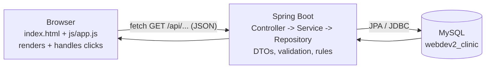

# Week 13 (F1) - Lecture Notes: Connected Foundation

**Student:** Stephanie Mhay D. De Leon (2510576) | **Repo:** https://github.com/stepanotchie/webdev2 | **Branch:** `week13`

> STUDY NOTE (delete before submitting): this is a draft. The facts (audit, contract, code references) match the code.
> Rewrite every explanation in YOUR OWN words and replace each `[FILL IN]` with what YOU actually observed.
> The handbook grades your own reasoning and evidence, so do not submit text you cannot explain out loud.

## 1. Baseline audit (what existed at the end of week 11)

| Area | Status at `week11` | Action in week 13 |
|---|---|---|
| Domain | Pet Clinic: `app_user` (owner), `pet`, `vaccine`, `vaccination_record` (4 related tables, FKs, unique `(pet, vaccine, dose)`) | Kept as is |
| Pet REST API | Full CRUD, DTOs, Bean Validation, `GlobalExceptionHandler`, pagination/sort/filter | Kept; behavior unchanged |
| Second resource | No endpoints for owners, vaccines or vaccination records | Added read endpoints (owners, vaccines, pet vaccination history) |
| Vaccine stock | Column did not exist | Added `stock_doses` (needed for the week 14 atomic workflow) |
| DB config | `ddl-auto=create` (wiped data every start), `root`, password committed in `application.properties` | Env-based config, `.env` git-ignored, `ddl-auto=validate` (schema now owned by `db/schema.sql`) |
| Startup runners | `Week11SmokeRunner` wrote data on every start and printed an old "WEEK 10" banner | Replaced by `smoke/PetApiSmokeRunner` (opt-in via profile `smoke`, current banner/messages, cleans up its own data); `db/seed.sql` seeds fictional related data |
| Code layout | All 20+ classes in one flat package `com`; names tied to old labs (`Week11Application`, `com.week7`, `taskmanager`) | Layered packages under `com.clinic`; project renamed to `clinic` |
| CORS | Hard-coded `http://localhost:3000` | Configurable via `CORS_ALLOWED_ORIGINS` |
| Frontend | None | Vanilla HTML/CSS/JS in `src/main/resources/static/` |
| Tests | None | Manual test cases T1-T10 (automated tests are planned for week 16) |

Known remaining weakness: the application still connects as MySQL `root` and the schema is generated by Hibernate. Both are scheduled for weeks 15 and 17.

## 2. Project structure

```
src/main/java/com/clinic/
  ClinicApplication.java
  controller/   PetController, OwnerController, VaccineController, VaccinationController   (HTTP only)
  service/      PetService, OwnerService, VaccineService, VaccinationService               (rules, transactions, entity -> DTO)
  repository/   PetRepository, AppUserRepository, VaccineRepository, VaccinationRecordRepository
  model/        Pet, AppUser, Vaccine, VaccinationRecord                                   (JPA entities)
  dto/request/  CreatePetRequest, UpdatePetRequest, PatchPetRequest                        (validated input)
  dto/response/ PetDTO, OwnerDTO, VaccineDTO, VaccinationRecordDTO                         (JSON output)
  exception/    GlobalExceptionHandler, ErrorResponse, ResourceNotFound/Duplicate/InvalidRequest exceptions
  config/       WebConfig (CORS)
  smoke/        PetApiSmokeRunner (opt-in API regression check, profile "smoke")
src/main/resources/static/   index.html, css/styles.css, js/{config,api,app}.js              (vanilla frontend)
db/                          schema.sql, seed.sql, views.sql, compare_queries.sql (copies of infoman1/week13)
docs/week13/                 lecture.md, checkpoint.md, evidence/
docs/api/                    pet-clinic.postman_collection.json
```

Dependencies only point downward: controller -> service -> repository -> model, and the controller/service exchange DTOs, never entities.

## 3. Architecture and data flow



Responsibilities:
- **Browser:** renders data, shows loading/empty/error states, never talks to MySQL, holds no secrets.
- **Spring Boot:** owns business rules, validation, (later) authorization; maps entities to DTOs.
- **MySQL:** owns stored data and integrity constraints (PK, FK, UNIQUE).

Example trace for "Show pet #1": `app.js showPet(1)` -> `getJson("/api/pets/1")` -> `PetController.getPetById` -> `PetService.findById` -> `PetRepository.findById` -> MySQL `pet` row -> `toDTO` -> JSON -> DOM via `textContent`.

## 4. Endpoint contract

| Method & path | Params | Success | Errors |
|---|---|---|---|
| `GET /api/pets` | `page`, `size` (<=100), `sort`, `direction`, `species` | 200 Page: records in `content[]` | 400 bad sort/direction/type |
| `GET /api/pets/{id}` | - | 200 `PetDTO` | 400 non-numeric, 404 not found |
| `GET /api/pets/{petId}/vaccinations` | - | 200 array (empty if none) | 404 unknown pet |
| `GET /api/owners`, `/api/owners/{id}` | `page`, `size` | 200 Page / `OwnerDTO` | 400, 404 |
| `GET /api/vaccines`, `/api/vaccines/{id}` | `page`, `size` | 200 Page / `VaccineDTO` | 400, 404 |

Error shape (all endpoints): `{ "status": 404, "message": "...", "timestamp": 1795255200000, "errors": null }`.
Full details and examples: [API.md](../../API.md).

**Pagination:** a list is not a raw array. The records are inside `content`; `app.js` checks `Array.isArray(page.content)` and reads paging data through `pageMeta()`. An empty result is `200` with `"content": []`, not 404.

## 5. DTO boundary (why entities are not returned)

[FILL IN, own words] Points to cover: entities have lazy relations (`Pet.owner`, `AppUser.pets`) and bidirectional links, so serializing them can trigger lazy-loading errors (`open-in-view=false` in this project) or infinite recursion; DTOs expose only the fields the browser needs (`PetDTO` has `ownerId`, not the whole owner); the mapping happens inside the service's transaction (`service/PetService.toDTO`, `service/VaccinationService.findByPet`), where lazy data is still loadable; the history query uses `JOIN FETCH` to avoid N+1 queries.

## 6. Origins and CORS

- An origin is scheme + host + port. `http://localhost:8080` (API + bundled frontend) and `http://localhost:5500` (a separate static server) are **different origins**.
- The default setup serves the frontend from Spring Boot, so page and API share an origin and no CORS rule is involved (`API_BASE = ""`).
- For the cross-origin experiment, the backend allows only the listed origin(s) in `CORS_ALLOWED_ORIGINS`, with only the needed methods; `no-cors` is never used (it produces an unreadable opaque response).
- CORS is a **browser** access rule. It is not authentication and does not stop `curl` or Postman. Real authorization comes in week 15.
- `js/config.js` is public (anyone can read it), so it holds only the API base URL, never secrets. The MySQL password stays on the server in environment variables.

## 7. One actual DevTools diagnosis

> Use a REAL observation. Steps to produce it are in `checkpoint.md` section 4 (Cross-origin experiment).

- **Symptom:** [FILL IN: what the page showed, e.g. "Cannot reach the server..." message]
- **DevTools evidence:** [FILL IN: Console message text; Network row: request URL, method, status, whether a preflight `OPTIONS` happened, presence/absence of `Access-Control-Allow-Origin` in the response headers] -> `evidence/05_cors_error_network.png`
- **Root cause:** [FILL IN: page origin `http://localhost:5500` not in `CORS_ALLOWED_ORIGINS` (was `http://localhost:3000`)]
- **Fix:** [FILL IN: set `CORS_ALLOWED_ORIGINS=http://localhost:5500`, restart backend, reload]
- **Result:** [FILL IN: requests return 200 and the list renders] -> `evidence/06_cors_fixed_network.png`
- **How I told it apart from other failures:** connection refused = nothing listening on the port; 404 = wrong path; 500 = backend exception in the server log; CORS = the server *did* answer but the browser refused to hand the response to the script.

## 8. SQL / API / UI comparison (Pet #1)

[FILL IN: paste the three results side by side: SQL row from `db/compare_queries.sql` (pet #1 queries), JSON from `GET /api/pets/1`, and the browser detail panel.] -> `evidence/04_sql_api_ui_comparison.png`
Conclusion: [FILL IN: values match / describe any mismatch and what you checked first (branch, datasource)].

## 9. Reflection

[FILL IN: one or two sentences on what you changed your mind about this week.]
